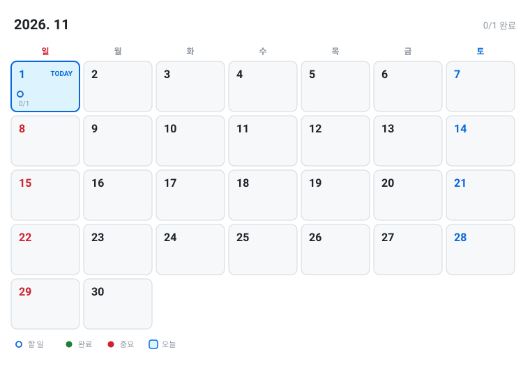

# 📅 2026-11

[◀ 2026-10](2026-10.md) | [🏠 홈](../README.md) | [📆 2026 연간](2026.md)

---

<picture>
  <source media="(prefers-color-scheme: dark)" srcset="../assets/calendar-2026-11-dark.svg">
  
</picture>

**📌 날짜를 클릭하면 그 날 세부 계획으로 이동해요.**

| 일 | 월 | 화 | 수 | 목 | 금 | 토 |
|:---:|:---:|:---:|:---:|:---:|:---:|:---:|
| [🔵**1**](#d1101) | 2 | 3 | 4 | 5 | 6 | 7 |
| 8 | 9 | 10 | 11 | 12 | 13 | 14 |
| 15 | 16 | 17 | 18 | 19 | 20 | 21 |
| 22 | 23 | 24 | 25 | 26 | 27 | 28 |
| 29 | 30 |   |   |   |   |   |

## 🎯 이번 달 목표

`░░░░░░░░░░░░░░░░░░░░░░` **0/1** (0%)

- [ ] 목표를 적어보세요

## 📖 11월 전체 계획

#### 11/01 (일) ← **오늘**

- [ ] 오늘 할 일

---

[◀ 2026-10](2026-10.md) | [🏠 홈](../README.md) | [📆 2026 연간](2026.md)

수정은 <a href="../plans/2026-11.md">plans/2026-11.md</a> 에서 하세요.
